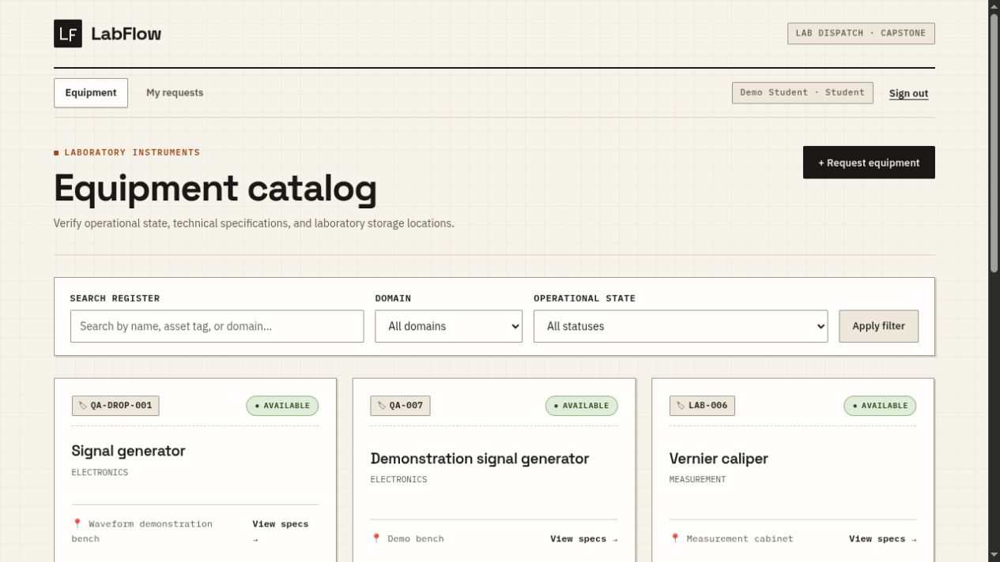

# LabFlow

[](https://www.mongodb.com/)
[](https://expressjs.com/)
[](https://react.dev/)
[](https://nodejs.org/)
[](https://vitejs.dev/)
[](https://github.com/milan-kb/LabFlow/actions)
[](docs/DECISIONS.md)

> A modern, transaction-safe MERN web application for managing individually tagged laboratory equipment, student loan requisitions, and inspected returns in a college laboratory.

**Live Application:** [labflow-lemon.vercel.app](https://labflow-lemon.vercel.app) · **API Readiness:** [labflow-lemon.vercel.app/api/health](https://labflow-lemon.vercel.app/api/health)

**Source repository:** [milan-kb/LabFlow](https://github.com/milan-kb/LabFlow)

## License

This project is licensed under the MIT License. See the [LICENSE](LICENSE) file for details.



LabFlow is a college laboratory equipment management system. Students find individually tagged equipment, submit borrowing requisitions, track loan status, and report equipment condition. Lab administrators manage inventory, validate return conditions and maintain the loan lifecycle.

## Stack

- **MongoDB & Mongoose:** Multi-document ACID transactions, optimistic concurrency control, and partial unique indexes.
- **Express & Node.js:** Strict schema boundary validation, scrypt password hashing, session regeneration, and rate limiting.
- **React & Vite:** Single-page application with responsive, accessible scientific instrument register UI.
- **Deployment:** Vercel Hobby serverless compute + MongoDB Atlas Free replica set (AWS Mumbai `AP_SOUTH_1`).

The architecture is a React client communicating with an Express JSON API; only the API accesses MongoDB.

## Capabilities

### Student

- Register, sign in and sign out
- Browse a searchable, paginated equipment catalog
- Select equipment and purpose from dropdowns, or describe Other; cancel eligible borrowing requests
- View request status and history
- Report damage for equipment currently issued to them

### Lab administrator

- Create, update, maintain and archive inventory records
- Assign an available registered asset for an unlisted need, then approve; or reject requests
- Record equipment issue and return
- Review damage reports and manage maintenance status
- View an operational dashboard

### Required qualities

- Server-enforced role and ownership checks
- Transaction-safe reservation, issue and return operations
- Validated API boundaries and consistent safe errors
- Responsive, keyboard-accessible user interface
- No secrets or credentials in the repository or application configuration

## Current status

**The application is deployed live in production on Vercel with MongoDB Atlas.** The release features an intuitive scientific-instrument register design, equipment/purpose dropdowns with custom input handling, and a full request issue-return lifecycle.

Scope and business rules are recorded in [decisions](docs/DECISIONS.md).

## Run locally

Use Node **24.21.0** and npm **11.19.0**. Install from the repository root:

```sh
npm ci --ignore-scripts
```

Create an ignored `server/.env` using these **local-only, non-secret** settings:

```dotenv
NODE_ENV=development
HOST=127.0.0.1
PORT=3000
MONGODB_URI=mongodb://127.0.0.1:27017/labflow?replicaSet=labflow-dev
APP_ORIGIN=http://127.0.0.1:5173
```

Generate `SESSION_SECRET` with at least 32 random characters and add it to the ignored `server/.env`. Then run these in three terminals, all from the repository root:

```sh
npm run db
npm run dev:server
npm run dev:client
```

Open **http://127.0.0.1:5173/**. The API is at **http://127.0.0.1:3000/api/health**.

## Verify

```sh
npm test
npm run test:integration
npm run lint
npm run build
```

## Production shape

Run `npm run build`, provide valid runtime configuration, then run `npm start` with `NODE_ENV=production`.

## Scope

This capstone system manages one college laboratory with two primary roles: student and lab administrator.

## Reference material

Two original ICTAK DOCX files remain in the local project root for reference. They are intentionally ignored by Git and are not part of the repository.

## Administrator provisioning

Set `ADMIN_NAME`, `ADMIN_EMAIL` and a strong `ADMIN_PASSWORD` in ignored runtime configuration, then run `npm run admin`.

## Verification and remaining release work

The current local review passes the repository checks and the core workflow remains verified in the project documentation.

- Review the [deployment evidence and operating limits](docs/DEPLOYMENT.md).
- Review the current [SRS](docs/SRS_DRAFT.md), [report source](docs/REPORT_DRAFT.md) and [submission checklist](docs/SUBMISSION.md).
