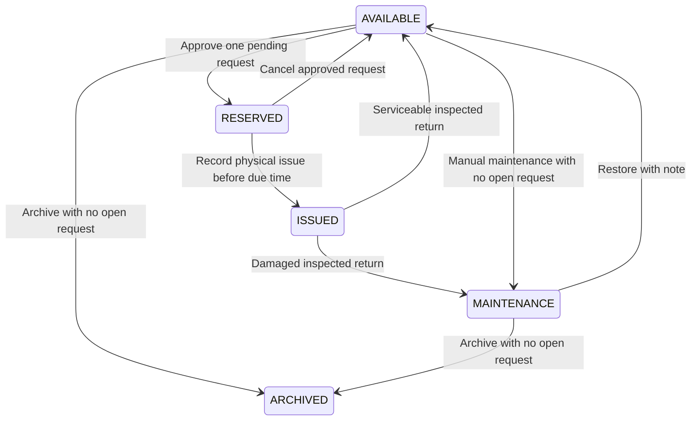
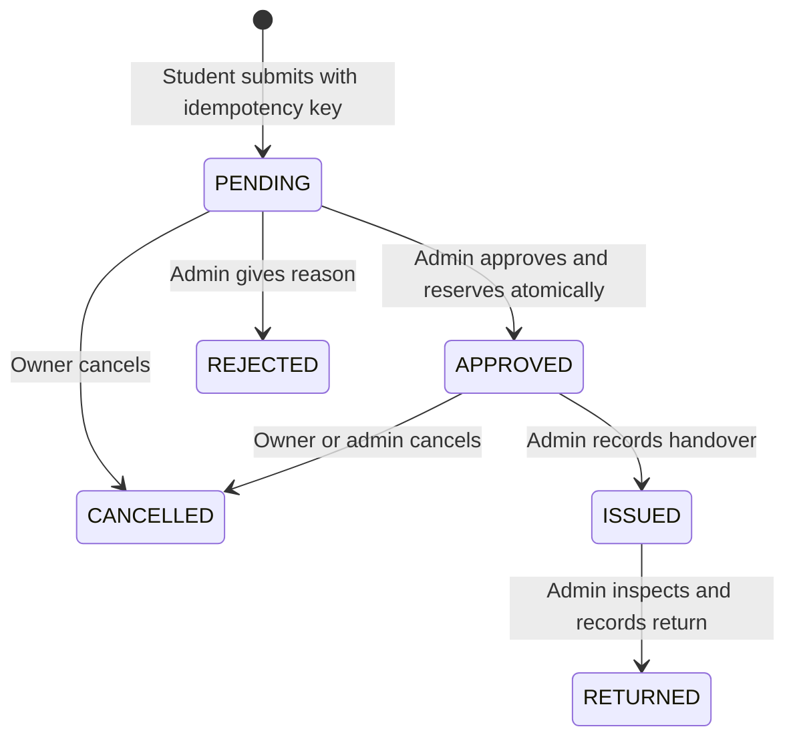
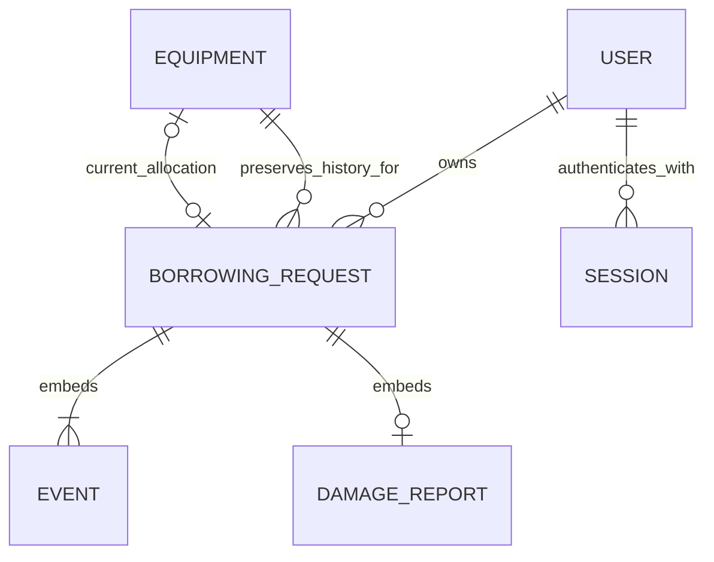

# LabFlow screen and data design

22 October 2026. Individual demo capstone, one lab. These layouts document the implemented scope; report screenshots in `docs/evidence/` show the locally implemented workflow. SRS approval remains pending.

## Navigation and screen coverage

| Screen | Student | Administrator | States and recovery |
|---|---|---|---|
| Welcome and identity | Login, registration | Login only | Pending, invalid fields, credentials rejected, rate limit, unavailable service |
| Catalog | Search/filter/page; archived excluded | All inventory; add asset | Loading, empty, error/retry, paginated results |
| Equipment detail | Description, condition, available request form | Versioned edit, maintenance, restore, archive | Unavailable/archived, stale version, open-request guard |
| Request list | Own history only | All requests, overdue/damage filters | Loading, empty, error/retry, pagination |
| Pending request | Purpose/date/timeline, cancellation | Approve with due date or reject with reason | Expired date and competing allocation conflicts |
| Approved request | Confirmed due, cancellation | Issue or cancel with reason | Expired reservation requires cancellation |
| Issued request | Single damage report | Physical return and inspection | Required inspection note, duplicate/report-return conflict |
| Terminal history | Own cancelled/rejected/returned records | All retained histories | Snapshot, timeline, inspection and report resolution |
| Overview | No access | Real equipment/request/loan/report counts | Loading, unavailable, refresh, empty counts |

Every protected screen uses the authenticated role from the server; hiding a control is not authorization. Owner-scoped API predicates are mandatory. Errors use safe messages. A conflict or uncertain mutation refreshes persisted state; mutations are never automatically retried.

## Desktop layouts

```text
LABFLOW                                         ICTAK demonstration
Overview [admin]    Equipment    Requests        Name / role   Sign out

PAGE TITLE                                      Primary action
Short explanation
Search                     Category        Availability       Apply

Asset tag / status         Asset tag / status         Asset tag / status
Equipment name             Equipment name             Equipment name
Category / location        Category / location        Category / location

Previous                         Page / total                       Next
```

Detail and lifecycle screens use the same header/navigation:

```text
Back to catalog or requests
Asset tag / name                                              Status
Feedback after an action

ABOUT OR REQUEST DETAILS             NEXT ACTION
Description / purpose                Student: request / cancel / report
Condition / requested and due dates   Admin: edit / decision / issue / return
Report and inspected result          Labelled fields and constraints
Chronological timeline               Submit / pending feedback
```

The overview places four filtered request links above equipment-state counts. Administrator request details show borrower name/email for handover; students do not receive contact fields. Archive opens an inline warning and requires a separate confirmation button. Identity screens pair a short introduction with a labelled login/registration form. No dashboard count or inventory record is fabricated in the interface.

## Phone layouts

```text
LABFLOW                 Demo
Equipment   My requests
Name / role   Sign out

Page title
Primary action
Search
Category
Availability
Apply filters

Asset tag         Status
Equipment name
Category
Location        View

Previous  Page  Next
```

Details stack content before the action form; forms use full-width labels/controls. Navigation wraps, cards become one column and timeline text wraps. Skip-to-content, native controls, visible focus, pending messages and safe errors apply across both sizes. The 320px and content-enlargement checks are recorded separately from unverified native browser zoom and screen readers.

## Equipment lifecycle



Damaged return enters maintenance even when unrelated requests remain pending. Restoration preserves those requests; approval additionally requires an unexpired requested date. Archived equipment is read-only and excluded from student discovery.

## Request lifecycle



Open means PENDING, APPROVED or ISSUED. Damage reporting is a single embedded report on an issued request, not another request state. Return resolves it with reviewer/time and the same inspection result. Overdue is a derived condition; it never releases equipment. Expiry is handled explicitly without a scheduled state change.

## Data relationships



Users contain normalized unique email, hash and server-controlled role. Equipment contains immutable unique tag, metadata, current state/allocation and expected version. Requests contain owner, asset, historical snapshot, UUID replay key, dates/state and embedded events/report. Sessions and HMAC authentication windows have TTL indexes. Sensitive fields are omitted from API responses. Unique partial indexes and shared transactional equipment writes serialize competing operations; see `docs/API_DETAILS.md` and the real database tests.
