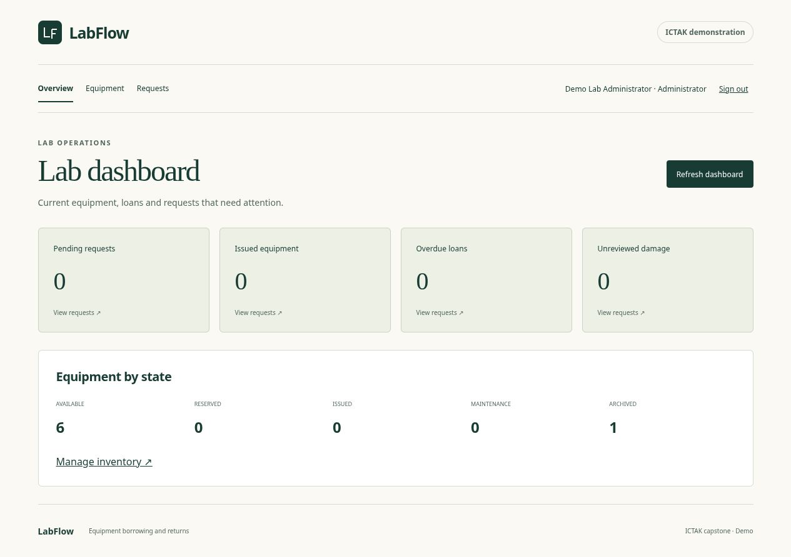
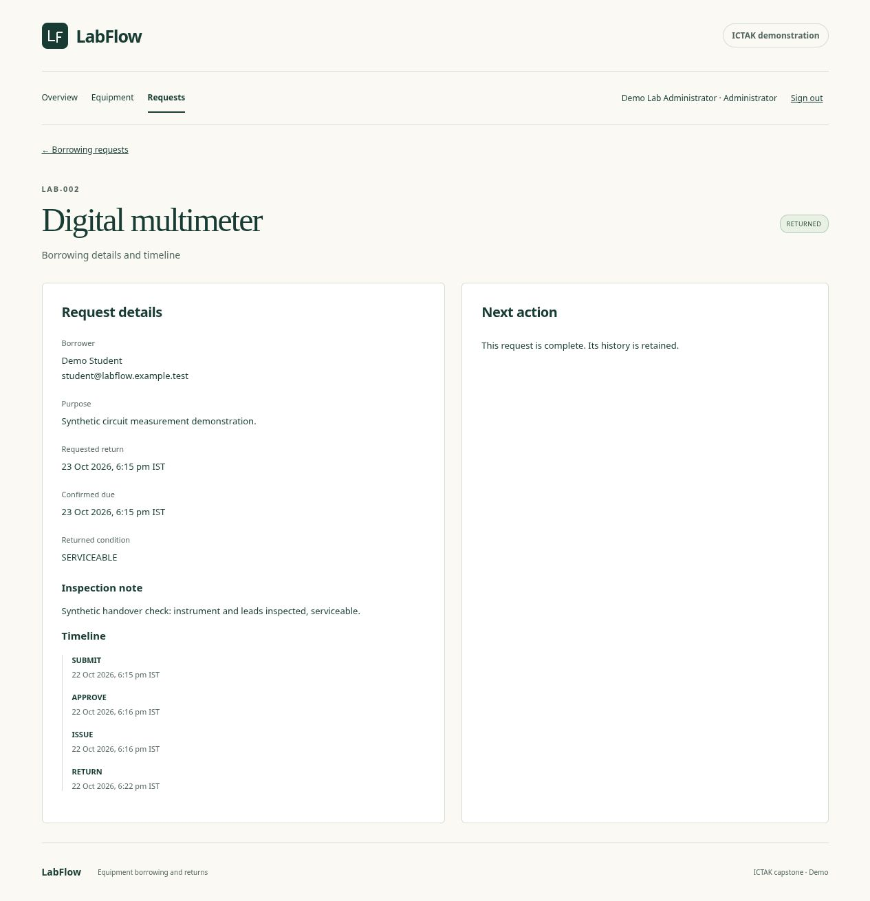

# LabFlow individual capstone report

Draft dated 22 October 2026. Prepared for review; not submitted. Author/student ID, institution, mentor and required submission date remain TBD. Source repository: [milan-kb/LabFlow](https://github.com/milan-kb/LabFlow). Hosted URL and live evaluation evidence remain pending.

## Executive summary

LabFlow is a MERN demonstration for managing individually tagged equipment in one college laboratory. It brings discovery, borrowing decisions, physical handover, inspected return and damage history into a shared system. Students can access their own requests; administrators manage inventory and circulation. The implementation uses React/Vite, Express and MongoDB/Mongoose with server validation, role checks and database transactions.

The local application completes the core borrowing journey and passes 45 automated tests. Real MongoDB tests exercise simultaneous approvals, conflicting actions and rollback after failed writes. Earlier local accessibility scans found no violations or incomplete findings; keyboard and responsive samples were also checked. These are local results. Public deployment, college approval and submission have not occurred, and the remaining browser checks are identified below.

## Introduction

Laboratory lending involves both digital decisions and physical equipment movement. A pending request should not make an asset unavailable, while an approved reservation must prevent another allocation. Informal records can obscure this distinction and lose the relationship between a borrower, return inspection and current condition.

LabFlow models these transitions explicitly. Equipment is tracked per physical asset instead of as a bulk quantity. A request preserves its original asset snapshot and chronological events so archival does not erase history. The project is an individual ICTAK demo, not a production campus identity or repair system. No interviews, institutional field study or measured improvement in a real laboratory is claimed.

## Objectives

- Maintain an accurate searchable inventory and asset state.
- Give students a clear request, cancellation and personal-history flow.
- Give administrators controlled decisions, issue, inspection and maintenance actions.
- Prevent cross-user access, unauthorized role changes and conflicting allocations.
- Demonstrate a responsive MERN application with reproducible verification and clear documentation.

## Scope and deliverables

The application supports one laboratory and two roles. Students register with name/email/password, sign in, browse non-archived assets, request one asset, cancel eligible requests and report damage while borrowing. Administrators create/edit/maintain/archive assets, approve or reject, record issue/return, resolve reports and view current counts. Loans are limited to 168 hours from approval. Times are stored in UTC and displayed in Asia/Kolkata.

Deliverables available locally include the application source, npm workspace/lockfile, SRS draft and review export, API/security/design/quality documents, regression tests, report screenshots, CI definition and deployment proposal. Multi-lab operation, payments, notifications, uploads, QR scanning, renewals and advanced analytics are excluded.

## Methodology

Development followed documented requirements and small verified increments in Git, preserving the initial M0 history. The working specification distinguishes accepted scope, selected implementation policies and unapproved submission details. The owner authorized coding on 21 October 2026 while SRS approval remained pending.

The browser calls a relative JSON API; only the server accesses MongoDB. Strict boundary schemas reject unknown fields and invalid IDs/dates. Authorization uses the stored session role and owner-scoped database queries. MongoDB transactions and unique partial indexes protect allocation; optimistic equipment versions detect stale edits. A real replica set, rather than browser mocks, verifies database behavior.

Passwords use salted asynchronous scrypt. MongoDB-backed sessions regenerate at login and expire absolutely after eight hours. Exact-origin/custom-header CSRF checks and an atomic ten-attempt fixed-window authentication limit protect mutations. Deployment secrets and local demonstration passwords remain outside Git.

## Project activities

The supplied ICTAK project guidelines and report template informed the requirements and report structure. Both original files remain unchanged.

The foundation established validated configuration, readiness, the React shell, a persistent local replica set and reproducible commands. Identity added registration, session behavior and controlled administrator provisioning. Inventory and circulation then added guarded state transitions and the corresponding student/admin screens.

Verification found and corrected three concrete issues. Mongoose transaction retries failed on an undefined embedded version field; explicit unversioned subdocument schemas retained parent concurrency control. A fresh clone exposed a concurrent first-download lock failure; explicit MongoDB preparation now precedes parallel tests. Production serving from a hidden checkout exposed an absolute-file dotfile guard; a fixed serving root resolved it and a regression fixture covers that location.

Accessibility testing found a mismatch between the logo's visible and accessible text. A decorative vector mark resolved the mismatch without disabling checks. The skip link was also fixed to focus content without changing the application route.

## Results and findings

| Verification | Observed local result | Evidence |
|---|---|---|
| Regression | 12 fast server, five client and 28 real database integration tests pass; lint/build pass | `npm run check` |
| Critical coverage | 99.41% lines and 92.66% branches; existing 80% gates enforced | `npm run test:coverage`; quality baseline |
| Concurrency and rollback | One approval winner; consistent cancellation/report-return races; injected approval/return failures roll back | Domain integration suite |
| Actual browser journey | Request, approve, issue, damage, inspected return and restoration passed with synthetic identities | Report screenshots; local browser review |
| Automated accessibility | Updated return screen at 1280px/320px and equipment archive disclosure: zero violations/incomplete findings | Local axe helper; broader earlier checks at `f6af63a` |
| Keyboard and reflow | Core keyboard flow, 320px samples and 200% CSS content enlargement checked | Historical verification at `f6af63a` |
| Fresh setup | A fully cold clone at 94bc7e9 installed, downloaded the pinned binary, and passed check/coverage | Historical verification at `f6af63a` |
| Performance | 30 warm sequential reads per endpoint: equipment p95 6.12ms, requests 7.03ms, dashboard 6.27ms; login sample 290.98ms | `evidence/performance.json` |
| Production process | Built assets/deep links and secure sessions checked locally after pruning development dependencies | `evidence/production-smoke.json` |

The measurements use a small synthetic loopback dataset and cannot predict load behavior or a sleeping free host. Native browser zoom, standalone stable Chromium and other-engine checks are not established by CSS enlargement or in-app testing alone. Screen-reader testing is also not claimed. Remote CI, real public HTTPS, Atlas acceptance and live screenshots remain pending.

## Conclusion

The local implementation demonstrates the intended single-lab borrowing workflow and verifies its main authorization and transaction invariants. Testing against real concurrent database operations and a cold setup exposed failures that a simple browser demonstration would have missed. The regression suite keeps these invariants reproducible as the application changes.

Completion for assessment still requires approval and execution of the proposed free deployment, public core-flow verification, the outstanding browser checks, final author/institution fields and the actual college submission procedure. This draft must be updated with genuine live results before it becomes the final report.

## Appendix

- Requirements and review copy: `SRS_DRAFT.md`, `exports/LabFlow_SRS_DRAFT_0.4.docx`.
- Design and contracts: `DESIGN.md`, `API_DETAILS.md`, `SECURITY.md`, `QUALITY.md`.
- Evidence: `evidence/`.
- Reproduction: root README, package lockfile and documented npm commands.
- Release proposal and pending live acceptance: `DEPLOYMENT.md`, root `render.yaml`.
- Business rules and implementation choices: `DECISIONS.md`.
- Source references: the unchanged local ICTAK project guidelines and internship report template. The supplied report reference defines the nine sections used here; its sample names/date are not project facts.
